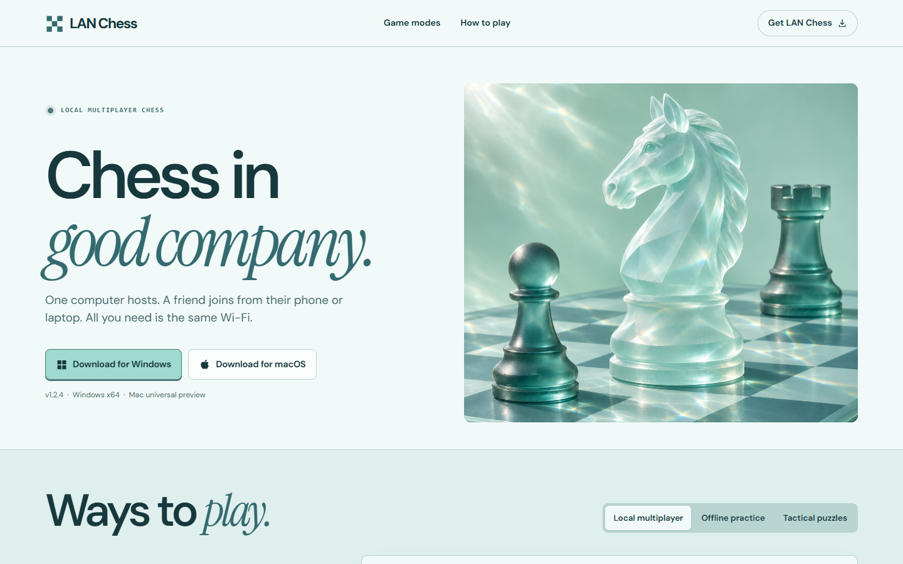

# LAN Chess

**Chess across the table.** Host a game on your computer and invite a friend on the same Wi-Fi. They can join from a phone or laptop browser. When you’re playing solo, face Stockfish, solve puzzles, or review a finished game offline.

[Download for Windows](https://github.com/darshitn/lan-chess/releases/download/v1.2.4/LAN-Chess-Setup-1.2.4.exe) · [Get the Mac preview](https://github.com/darshitn/lan-chess/actions/runs/45443792966#artifacts) · [Release notes](CHANGELOG.md)



## Play a game

1. Open LAN Chess on your computer, choose a clock, and create a room.
2. Share the room link or show your guest the QR code.
3. Your guest opens the invitation in a browser on the same local network.

| Platform | Installation |
| --- | --- |
| **Windows x64** | Download and run the v1.2.4 EXE. Existing installations with the updater can also check **Settings → Updates**. |
| **macOS** | Sign in to GitHub to download the universal preview artifact for Apple Silicon and Intel. See the [desktop guide](DESKTOP_APP.md#macos) for installation and Gatekeeper details. |

## Explore the app

| | What you can do |
| --- | --- |
| **Play with friends** | Choose from bullet, blitz, rapid, or untimed games. Use premoves, invite spectators, chat in the room, or play a rematch. |
| **Play solo** | Play offline against Stockfish at five difficulty levels. Configure the clock and choose White, Black, or a random side. |
| **Review and train** | Step through moves during a live game, review completed games with Stockfish and an evaluation graph, or solve 1,320 offline tactical puzzles from Lichess. Game history supports PGN and FEN tools. |
| **Make the board yours** | Resize the board, use Focus Board or fullscreen, and choose from 19 board themes and eight piece sets. Preferences are stored locally. |

## Develop locally

The app uses React, TypeScript, Vite, and Tailwind CSS. Express and Socket.IO manage LAN games, with chess.js validating moves. Stockfish runs in a browser worker for offline play and analysis. Electron packages the desktop app.

Use Node.js 24, which matches the desktop build workflow.

```sh
npm ci
npm run dev
```

Vite runs on port 5173 and proxies requests to the game server on port 3001. For a production-style LAN run, use `npm run build` followed by `npm start`, then share the LAN address printed by the server.

```sh
npm test
npm run typecheck
npm run build
```

See the [desktop guide](DESKTOP_APP.md) for packaging commands, updates, and storage details. If a guest can’t connect, check that both devices are on the same network and use the host’s displayed LAN address. Some guest networks isolate devices, and a server restart clears active rooms.

## Landing page and Vercel

Preview the site with `node site/server.cjs` at [localhost:5050](http://localhost:5050/). After editing the Tailwind source, regenerate the checked-in CSS with `npm run site:css`.

In Vercel, import the **repository root**. [vercel.json](vercel.json) uses the **Other** preset and builds the static landing page without installing app dependencies.

```sh
node site/build.cjs --vercel
```

The deployment output is `dist/vercel-marketing`. Windows downloads are served by GitHub Releases. For macOS, the build uses a checksum-matched release asset when available and otherwise labels the GitHub Actions preview and its sign-in requirement. You can set `LAN_CHESS_MAC_DOWNLOAD_URL` in Vercel to a public HTTPS URL for the verified DMG.
